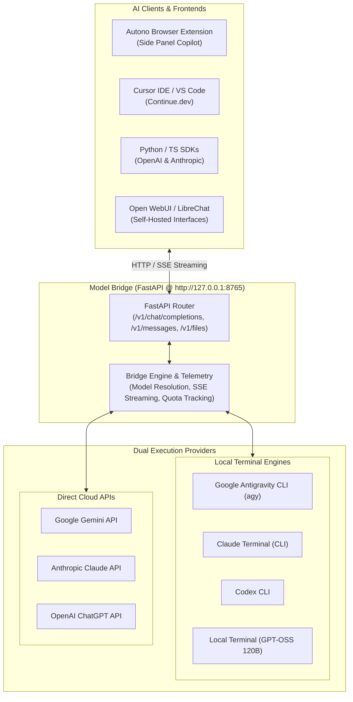

# Model Bridge

<div align="center">
  <h3>⚡ High-Performance Local Gateway for Google Antigravity, Anthropic Claude & OpenAI Models</h3>
  <p>
    
    
    
    
    
    
  </p>
  <p>
    <em>Universal local gateway connecting AI browser extensions, developer tools, and custom scripts to frontier AI models with zero unnecessary overhead.</em>
  </p>
</div>

---

## 🌟 Overview

**Model Bridge** is an open-source, local FastAPI server that exposes industry-standard API endpoints (`/v1/chat/completions`, `/v1/responses`, `/v1/messages`, `/v1/models`, `/v1/files`). It acts as a bidirectional bridge between client applications and underlying local CLI tools or official provider APIs:

1. **Google Antigravity & Gemini**:
   - **Local Terminal**: Powered by the local Antigravity CLI (`agy`) and `google-antigravity` SDK.
   - **Gemini API**: Direct execution for Google Gemini models via Gemini API Key.
   - *Models*: Gemini 3.8 Flash, Gemini 3.7 Flash, Gemini 3.6 Flash, Gemini 3.1 Pro.
2. **Anthropic Claude**:
   - **Local Terminal**: Local CLI execution via Claude Terminal environment.
   - **Claude API**: Direct connection using Anthropic API Key.
   - *Models*: Claude Sonnet 5.5, Claude Opus 5.5, Claude Fable 5.1, Claude Haiku 4.5, Claude Sonnet 4.6, Claude Opus 4.6.
3. **OpenAI & Codex**:
   - **Local Terminal**: Local CLI execution via Codex CLI environment.
   - **ChatGPT API**: Direct connection using OpenAI API Key.
   - *Models*: GPT-6 Astra, GPT-6 Sol, GPT-6 Luna, GPT-5.6 Terra, GPT-5.6 Sol, GPT-5.6 Luna.
4. **GPT-OSS 120B**:
   - Local terminal execution or direct execution via OpenAI API (strictly isolated from Gemini API).

---

## 🏗️ Architecture



---

## 🚀 Features

- **Standard OpenAI API Compatibility**:
  - `POST /v1/chat/completions`: Full support for Server-Sent Events (`stream: true`) and non-streaming responses.
  - `POST /v1/responses`: OpenAI Responses API structure.
  - `GET /v1/models` and `GET /v1/models/{model_id}`: Live model registry with capability annotations.
  - `POST /v1/files`, `GET /v1/files`, `DELETE /v1/files/{file_id}`: Multimodal document and image uploads.
- **Model Context Protocol (MCP) Server**:
  - `POST /mcp`: Standard MCP JSON-RPC 2.0 protocol endpoint.
  - `GET /mcp/sse`: Server-Sent Events endpoint for MCP clients like Cursor.
  - `mcp_server.py`: Stdio adapter for Claude Desktop, Claude Code, and local agents to automate the active Autono browser session (`browser_task`, `browser_navigate`, `browser_click`, `browser_type`, `browser_screenshot`, `browser_get_active_tab`).
- **Anthropic Claude Agent SDK Compatibility**:
  - `POST /v1/messages`: Drop-in replacement for the official `anthropic-python` SDK (`base_url="http://127.0.0.1:8765"`).
  - `POST /v1/claude/agent`: Autonomous web automation agent execution with tool calling (click, type, navigate, screenshot).
  - Extended thinking / Chain-of-Thought token budget handling (`thinking: {"type": "enabled", "budget_tokens": ...}`).
- **Dual Runtime Modes**:
  - **Modern Blue GUI**: Centered, high-clarity desktop interface with live start/stop button, 3 provider cards (Claude Code, Anti Gravity, Codex CLI) with dynamic **Activated** status detection, and real-time metrics.
  - **Headless Server**: Run in continuous server/CI mode using `uv run main.py --headless`.
- **CORS Enabled**: Configured for local cross-origin browser extensions, local webapps, and sandboxes.
- **Zero Paid Key Requirement**: Uses your active local Antigravity authentication session when running in Local Terminal mode.

---

## 📦 Prerequisites & Quick Start

### 1. Prerequisites
- **Windows 10/11** (the GUI and the one-click scripts) — headless mode also runs on Linux/macOS.
- **No Python needed in secure mode (the default).** The installer uses [uv](https://docs.astral.sh/uv/) to create an isolated environment (`.venv`) with its own Python, so it never touches (or depends on) the Python installed on your system. *Normal mode* instead uses the Python you already have (3.10+); see below.
- *(Optional)* [Google Antigravity CLI](https://antigravity.google) for local Antigravity execution (the installer sets it up for you).

### 2. Install (one command)

```powershell
irm https://raw.githubusercontent.com/MatiasV3B/ModelBridge/main/install.ps1 | iex
```

This downloads the Bridge to `%LOCALAPPDATA%\AntigravityBridge`, installs `uv` if missing, builds the `.venv`, creates the Desktop / Start Menu shortcuts and launches it.

Already cloned the repo? Double-click `Instalador-AntigravityBridge.bat` (or run `./install.ps1`).

#### Install modes

| Mode | What it does | When to pick it |
|---|---|---|
| **Secure** (default, recommended) | Creates an isolated `.venv` with `uv` and its own Python. Nothing is added to your system Python. | Almost always. Removing the Bridge is deleting its folder. |
| **Normal** | Installs the dependencies with plain `pip install --user` into the Python you already have. | You do not want `uv` / a second Python. It mixes packages with your own and can change versions you already have. |

An interactive install asks which one you want. To choose without being asked:

```powershell
./install.ps1 -Mode normal                                   # or: -Mode secure
$env:BRIDGE_INSTALL_MODE = 'normal'; irm https://raw.githubusercontent.com/MatiasV3B/ModelBridge/main/install.ps1 | iex
```

The choice is saved in `.install-mode` and the updater keeps using it. In normal mode the Python path is saved in `.python-path`, which every launcher (`Iniciar-*.bat`, `*.vbs`, `run.bat`) reads. To switch modes, run `./install.ps1 -Mode secure` (or `normal`) again.

<details>
<summary>Manual setup (Linux/macOS or advanced)</summary>

```bash
git clone https://github.com/MatiasV3B/ModelBridge.git
cd ModelBridge
uv sync                      # creates .venv with the pinned Python + locked dependencies
uv run main.py --headless    # start the server
```
</details>

### 3. Update

Double-click `Actualizar-AntigravityBridge.bat` (or run `./update.ps1`). It stops the Bridge, pulls the latest code, runs `uv sync` (only installs what changed) and restarts it.

### 4. Launching the Bridge

#### Option A: Headless Mode (CLI / Server / Container)
```bash
uv run main.py --headless --host 127.0.0.1 --port 8765
```

#### Option B: Windows GUI
Use the **Antigravity Bridge** shortcut, or double-click `Iniciar-AntigravityBridge.bat`.

#### Option C: Silent Background Service (Windows)
Double-click `Iniciar-Servicio-Fondo.bat` (to stop, run `Detener-Servicio-Fondo.bat`).

---

## 🔌 Client Integration Examples

Once the server is running on `http://127.0.0.1:8765`:

### 1. Autono Browser Extension
In the [Autono](https://github.com/MatiasV3B/Autono) side panel:
- Open **Settings** → **Bridge Connection**.
- Bridge URL: `http://127.0.0.1:8765`.
- Verify the green status indicator (`🟢 Bridge Connected`).

### 2. Python OpenAI SDK
```python
from openai import OpenAI

client = OpenAI(
    base_url="http://127.0.0.1:8765/v1",
    api_key="sk-antigravity",  # Any non-empty string in Local Terminal mode
)

stream = client.chat.completions.create(
    model="gemini-3.8-flash-medium",
    messages=[
        {"role": "system", "content": "You are a helpful software architect."},
        {"role": "user", "content": "Explain reactive stream architectures concisely."},
    ],
    stream=True,
)

for chunk in stream:
    text = chunk.choices[0].delta.content or ""
    print(text, end="", flush=True)
```

### 3. Python Anthropic SDK
```python
from anthropic import Anthropic

client = Anthropic(
    base_url="http://127.0.0.1:8765",
    api_key="sk-antigravity",
)

message = client.messages.create(
    model="claude-sonnet-5-5",
    max_tokens=1024,
    messages=[
        {"role": "user", "content": "Analyze this code structure for performance bottlenecks."}
    ],
)
print(message.content[0].text)
```

### 4. Cursor IDE / Continue.dev
In your `config.json`:
```json
{
  "models": [
    {
      "title": "Antigravity Gemini 3.8",
      "provider": "openai",
      "model": "gemini-3.8-flash-medium",
      "apiBase": "http://127.0.0.1:8765/v1",
      "apiKey": "sk-antigravity"
    }
  ]
}
```

### 5. cURL Request
```bash
curl http://127.0.0.1:8765/v1/chat/completions \
  -H "Content-Type: application/json" \
  -H "Authorization: Bearer sk-antigravity" \
  -d '{
    "model": "gemini-3.8-flash-medium",
    "messages": [{"role": "user", "content": "Say hello!"}]
  }'
```

---

## 📡 API Reference

| Endpoint | Method | Description |
| :--- | :--- | :--- |
| `/health` | `GET` | Server status, version, and active engine configuration |
| `/v1/chat/completions` | `POST` | OpenAI-compatible chat completion (streaming SSE & sync) |
| `/v1/responses` | `POST` | OpenAI Responses API format |
| `/v1/messages` | `POST` | Anthropic Messages API format |
| `/v1/claude/agent` | `POST` | Autonomous web task execution agent |
| `/v1/tts/status` · `/v1/tts/voices?lang=es` | `GET` | Piper text-to-speech: engine state and the voice catalogue by language |
| `/v1/tts/engine/install` · `/v1/tts/voices/download` · `/v1/tts/speak` | `POST` | Install the Piper engine (into `~/.antigravity_bridge/piper`, never into your Python), download a voice, or turn text into a WAV. Piper is GPL-3.0 and is installed only when you ask for it. |
| `/v1/stt/status` | `GET` | Parakeet speech-to-text: engine and model state, download progress |
| `/v1/stt/engine/install` · `/v1/stt/model/download` | `POST` | Install `onnx-asr` into `~/.antigravity_bridge/stt` (never into your Python) and download the int8 model (about 650 MB, CC-BY-4.0) |
| `/v1/stt/transcribe` | `POST` | Body: a 16-bit PCM WAV. Returns `{text}`; English and Spanish are detected automatically |
| `/v1/bridge/restart` | `POST` | Hard restart: closes this Bridge and any leftover of it, frees the port and starts a new one (also `Reiniciar-Servicio-Fondo.bat`) |
| `/v1/update/status` | `GET` | Compares the installed Bridge and Autono with the latest commit on GitHub |
| `/v1/update/bridge` · `/v1/update/extension` | `POST` | Apply the update (git pull, or the repo ZIP laid over a downloaded copy), then restart / reload |
| `/v1/agents/run` | `POST` | Run several sub-agents in parallel, one CLI process each (streams `agent_start` / `agent_done` / `run_done` events); also under `/antigravity`, `/claude` and `/openai` |
| `/v1/models` | `GET` | List all available models across providers |
| `/v1/models/{model_id}` | `GET` | Retrieve specific model details and metrics |
| `/v1/files` | `POST` | Upload images, documents, and code files |
| `/v1/files` | `GET` | List active session files |
| `/api/metrics` | `GET` | Live telemetry, request logs, and token counters |
| `/api/permissions` | `GET` / `POST` | Permission mode (`ask` / `auto` / `none`) and the hard limits. Only the Autono extension (or a local tool with no browser `Origin`) can change it; a web page gets `403`. |
| `/api/power/shutdown` | `POST` | Always `403`: the Bridge never shuts down or hibernates the computer (use `/api/power/sleep`) |
| `/api/code/execute` | `POST` | `403` unless you turned code execution on locally (see below) |

---

## 🛡️ Permissions & safety

> **Read this before using `auto` or `none`.** A model that can act on your computer can be steered by text it reads (a web page, a file, an email: *prompt injection*). With the prompts turned off, nobody stops it. Use these modes at your own risk: the authors are not responsible for what a model does on your machine. The limits below are what actually protects you, not this warning.

**Permission mode** (set it from the Autono Settings tab, or `POST /api/permissions`; stored in `permission_mode` in `~/.antigravity_bridge/config.json`):

| Mode | Antigravity CLI | Meaning |
|---|---|---|
| `ask` (default) | `--sandbox` | Nothing outside the sandbox is approved on its own. A headless request cannot ask in the middle, so a tool that needs permission (opening links, deleting files) is refused and the answer says which one (`[Blocked: ...]`). It is **not** a read-only mode: safe actions inside the sandbox, such as writing a temporary file, still run without asking. |
| `auto` | `--sandbox --dangerously-skip-permissions` | Every tool request is approved without asking. |
| `none` | `--sandbox --dangerously-skip-permissions` | Same here; the extension also skips its own confirmation dialogs. |

**Hard limits** (the same in every mode; none of them can be changed over HTTP, so a web page or an injected prompt cannot lift them):

- The Antigravity CLI always runs with `--sandbox`.
- The computer is never shut down or hibernated (`/api/power/shutdown` always answers `403`).
- Code from `/api/code/execute` is **off**. To use it, set `"code_execution": "isolated"` in `config.json` (or `BRIDGE_CODE_EXECUTION=isolated`) on this computer. It then runs only Python or JavaScript, in an empty temporary folder, without your API keys, with a time limit; no shells. This is a best-effort isolation, not a security boundary: that code can still read the files your user can read.

The Claude and Codex CLIs are already started without tools / with a read-only sandbox, whatever the mode.

---

## 🤝 Contributing

Contributions are welcome! Please check our [Contributing Guidelines](CONTRIBUTING.md) and [Code of Conduct](CODE_OF_CONDUCT.md).

1. Fork the repository.
2. Create your feature branch (`git checkout -b feat/my-improvement`).
3. Commit your changes (`git commit -m 'feat: add support for custom provider'`).
4. Push to the branch (`git push origin feat/my-improvement`).
5. Open a Pull Request.

---

## 📄 License

Distributed under the MIT License. See [`LICENSE`](LICENSE) for details.
